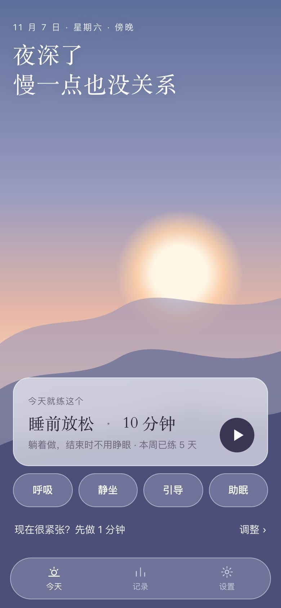
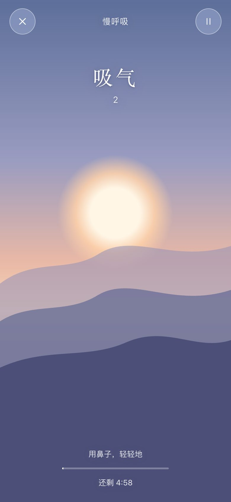
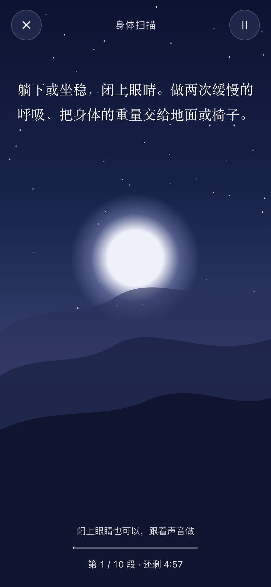
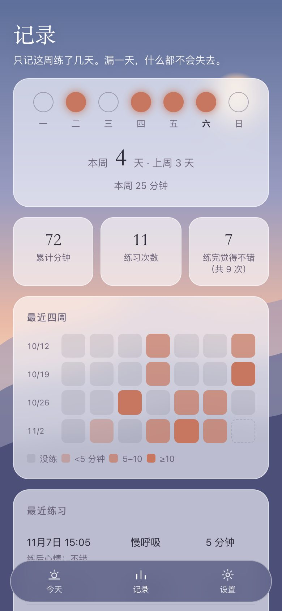

# 一息 · 呼吸与冥想

一个打开就能练、不收费、无广告、无账号、可离线的中文呼吸与冥想小工具。

**在线使用：<https://lucas0ng.github.io/yixi/>**　·　**单文件下载：[一息.html](download/一息.html)**

  
  
  
  

## 亮点

**打开就能练，不用做选择。** 首页只推一个“今天就练这个”，点一下就开始：第一次用推荐慢呼吸，早上推荐慢呼吸，晚上 9 点后推荐睡前放松，其他时间接着你上次练的。想换时长，点卡片上的“5 分钟”就能改；想换练习，下面有“呼吸 / 静坐 / 引导 / 助眠”四个入口。紧张的时候还有“先做 1 分钟”。点开始后一秒内就有声音。

**第一次练？有一门 7 天入门课。** 每天一课、5–10 分钟：先听半分钟讲解，再跟着人声练，练完给一个生活里随手能做的小练习。依次练呼吸、身体、声音、念头、日常的呼吸空间、善意和自由静坐，参考正念减压（MBSR）、正念认知疗法（MBCT）等课程的入门顺序。不锁课，漏了就接着上次的。

**一片跟着时间变化的天空。** 清晨、白天、傍晚、夜晚四种天色自动切换，夜里有星星和月亮。呼吸练习时，太阳随吸气从山后升起、随呼气落下，跟着它呼吸就好。

**闭上眼睛也能练。** 引导练习有温柔的人声朗读，呼吸练习用颂钵声提示吸气和呼气（吸气一声高、呼气一声低）。锁屏后声音继续播放，可以在锁屏界面暂停。

**睡前陪你睡着。** 助眠练习结束后，雨声或海浪可以再陪你 15 或 30 分钟，最后几分钟慢慢变小直到无声，锁屏也能放完。

**不打扰。** 不收费、不弹窗、不推送、不要求注册，练习前不插任何问答。想被提醒的话，练完点“明天这个时间再来”，会在系统日历里加一个每天重复的日程，由日历提醒你，删掉日程就不再提醒。做之前我们分析了 9 款冥想 App 的 1,300 条 App Store 评论：用户卸载的主要原因是误触扣费、退款难、开屏广告和弹窗，而不是练习本身。

**不惩罚人。** 只记“这周练了几天”，和上周比一比，没有断一天就清零的连续打卡。练完可以记一下心情，也可以跳过。

**数据只在你的设备上。** 记录存在浏览器本地，不上传到任何地方；可以导出、导入，方便换手机或换电脑。

## 练习方法的依据

| 设计 | 依据 |
|---|---|
| 默认 5 分钟，可选 1–20 分钟 | 2025 年 JAMA Network Open 的员工压力试验中，平均每天练 5–10 分钟的人压力下降更多；Medito 每天 10 分钟、30 天的试验（2024）效果在两个月后仍在 |
| 循环叹息（两次吸气、一次长呼气） | Balban 等 2023（Cell Reports Medicine）：每天 5 分钟、为期一个月，对情绪的改善比正念冥想更明显 |
| 慢呼吸（吸 4 秒、呼 6 秒，每分钟约 6 次） | Shao 等 2024 荟萃分析（31 项研究）：短期内心血管指标改善、负面情绪减轻 |
| 不做会清零的连续打卡 | Lally 等 2010 的习惯研究：偶尔漏一两天对习惯形成没有明显影响 |
| “感到不适就停下”的提示 | Farias 等 2020 系统综述：冥想练习中也会出现焦虑等不适 |

## 练习内容

| 分类 | 练习 |
|---|---|
| 呼吸 | 循环叹息、慢呼吸、方块呼吸 |
| 静坐 | 静坐计时，可设间隔钵声 |
| 引导（人声） | 呼吸觉察、身体扫描、慈心 |
| 助眠 | 睡前放松（结束时不用睁眼），也可选身体扫描、慢呼吸；练完后背景声可再响 15 或 30 分钟 |
| 入门课 | 7 天，每天一课：回到呼吸、落回身体、听见声音、看见念头、日常里的呼吸空间、安放情绪与善意、留白与自由静坐 |

背景声可选雨声、海浪、温暖长音，音量可调。

## 怎么用

- **iPhone**：用 Safari 打开 <https://lucas0ng.github.io/yixi/> ，点“分享 → 添加到主屏幕”，之后从桌面图标打开，打开过一次就能离线用。如果从桌面图标打开时锁屏会停声，改在 Safari 里直接打开更稳定（部分 iOS 版本的已知问题）。
- **安卓**：用 Chrome 打开同一个网址，菜单里选“添加到主屏幕”。
- **电脑**：直接打开网址；或者下载 [一息.html](download/一息.html)，双击就能用，不需要网络。

## 技术

纯 HTML、CSS、JavaScript，没有框架，也不需要构建。钵声和背景声用 Web Audio 实时合成；每次练习开始前，人声、钵声、背景声会拼成一条完整音轨（每种声音只合成一次，再按时间表直接拼接，不到一秒），用浏览器的媒体播放器播放，所以锁屏后还能继续。Service Worker 负责离线缓存。

人声由豆包语音合成 2.0 生成。

## 说明

一息是放松练习工具，不能代替医疗或心理治疗。如果练习中感到头晕、心慌或情绪明显不适，请停下来，睁开眼睛，恢复平常的呼吸。

## 许可

代码使用 [MIT](LICENSE) 许可。
